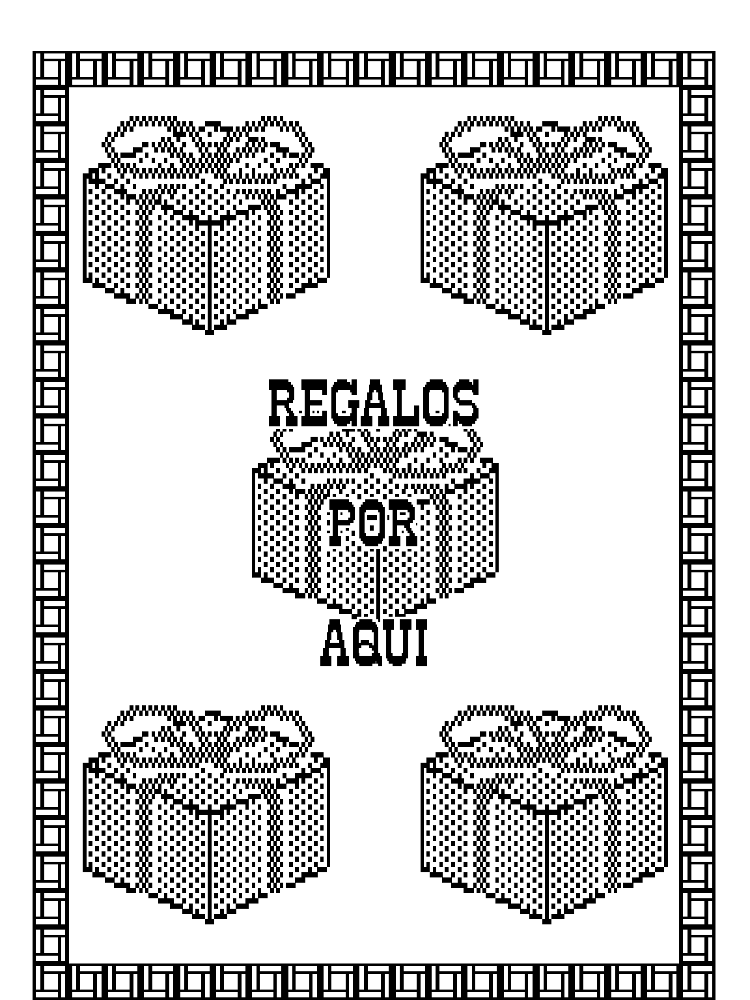
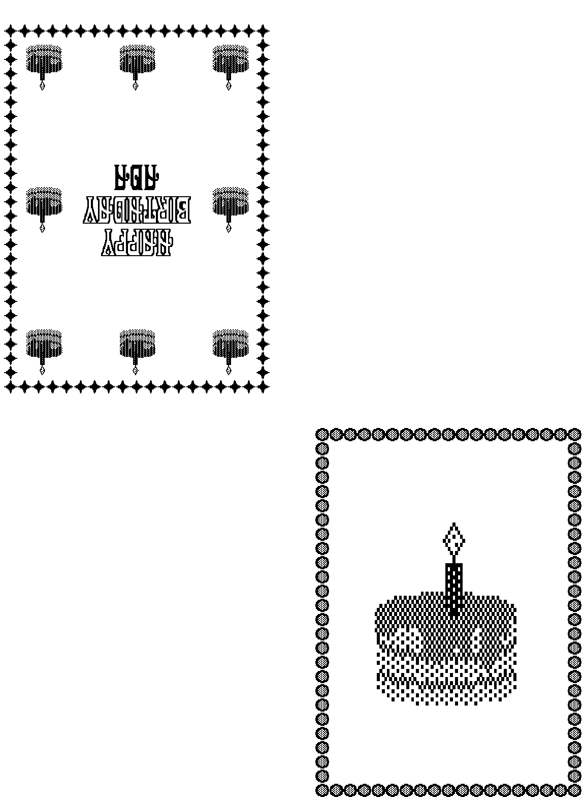

Experiments on how ImageWriter II works.

To see the sixel graphics on the command line use `xterm -ti vt340` or `mlterm`

To save the graphics as a GIF picture of the paper, 144 pixels per inch:

```bash
go run . -gif sign.gif < samples/sign8bits.prn
```

Each dot is placed where the print head puts it: across at the dots per
inch of the pitch, and down by the line feeds and the distance between
lines of `ESC T`, `ESC A` and `ESC B`, with the colors of `ESC K`. Only the
graphics are drawn, not the text.

The samples have the picture of each next to it, made so. A sign of The
Print Shop:



With `-epson` it reads the codes of an Epson printer, as the FX-80, instead
of those of the ImageWriter: the graphics of `ESC K`, `ESC L`, `ESC Y`,
`ESC Z` and `ESC *`, the top dot in the most significant bit, the distance
between lines of `ESC 0`, `ESC 1`, `ESC 2`, `ESC 3` and `ESC A`, and the
colors of `ESC r`. A greeting card of The Print Shop, printed for an Epson:

```bash
go run . -epson -gif card.gif < samples/cardEpson.prn
```


